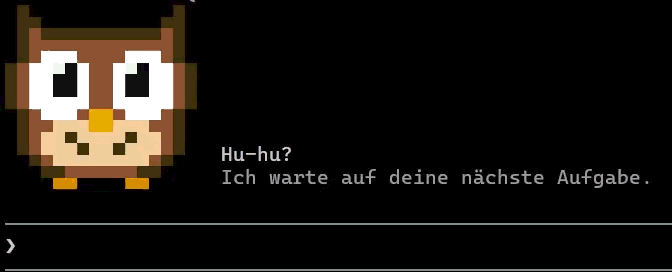

# Clowl

[Deutsch](README_de.md)

A mod for Claude Code: a dopey, devoted-looking owl above the prompt while Claude waits for your next task. It looks at you, blinks about every 5 seconds (sometimes twice), and disappears as soon as Claude gets to work.



- 16 × 16 pixel art made of half-block characters (16 columns × 8 rows), terminal only.
- Hidden while a survey is shown or when the band is too small; dismiss it with `[-]` on the right of the band.

## Installation

In a Claude Code session in the terminal, type:

```
/plugin install clowl --marketplace Carismarkus/clowl
```

Answer `y` when asked whether to add the marketplace, then choose the scope (`user` = all projects).

## How do I change the text?

Next to the owl there are two lines: "Hu-hu?" ("Hoo-hoo?") and below it, dimmed, "Ich warte auf deine nächste Aufgabe." ("I'm waiting for your next task."). Both are at the very top of `hooks/register.tsx`:

```ts
const TEXT = 'Hu-hu?'
const SUBTEXT = 'Ich warte auf deine nächste Aufgabe.'
```

1. Install the mod from a local folder so Claude Code reads it from your copy (see "From a local folder" below). An installation from GitHub lives in a Claude Code cache; changes made there are lost on the next update.
2. Change the text between the single quotes and save the file. If the text itself contains a `'`, put a backslash in front of it: `'What\'s up?'`.
3. An empty line (`''`) is left out: with `SUBTEXT = ''`, only one line appears next to the owl.
4. Type `/reload-plugins` in Claude Code. The owl shows the new text the next time Claude is waiting.

The picture and colors are in the same file: `OWL` (one letter per pixel) and `PALETTE` (color per letter).

## From a local folder

Clone or download the repo, then (adjust the path):

```
claude plugin marketplace add "C:\path\to\clowl"
```

```
claude plugin install clowl@clowl --scope user
```

`/reload-plugins` picks up changes in the folder.

## Development

- Check: `claude plugin validate .` and `claude plugin test .`

## License

MIT, see [LICENSE](LICENSE).
